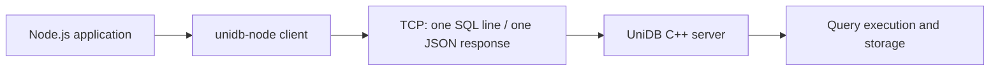

# unidb-node

A small Node.js client for connecting to the [UniDB](https://github.com/soujash-mandal/UniDB) database server.

The goal is to make UniDB straightforward to use from a JavaScript backend without making every application handle TCP sockets and response parsing itself.

> **Early version:** this client follows the current UniDB newline-delimited SQL protocol. It is not a PostgreSQL driver, and it does not add SQL features that the server does not support.

## How it fits together



## Requirements

- Node.js 18 or newer.
- A running UniDB server. By default, the server accepts local connections at `127.0.0.1:7432`.

## Install

Once the package is published, install it with:

```sh
npm install unidb-node
```

For now, this repository can be used directly while development is underway.

## Connect and run a query

```js
import { UniDB } from "unidb-node";

const db = new UniDB({
  host: "127.0.0.1",
  port: 7432,
});

await db.connect();

try {
  const result = await db.query("SELECT * FROM users");
  console.log(result.rows);
} finally {
  await db.close();
}
```

The client defaults to `127.0.0.1:7432`. You can set `connectTimeout` and `queryTimeout` in milliseconds when creating the client.

## Results and errors

A row query returns the server response, including column metadata and rows:

```js
{
  ok: true,
  kind: "rows",
  columns: [{ name: "id", type: "int" }],
  rows: [[7]]
}
```

A command query returns `kind: "command"`, a message, and `affected_rows`. When a query fails, `query()` rejects with `UniDBQueryError`. Connection problems use `UniDBConnectionError`; malformed responses use `UniDBProtocolError`. Each error has a `code` field.

The current server protocol accepts one SQL statement per line and sends one JSON response per line. For that reason, `query()` rejects SQL strings containing newline characters. A query timeout closes the connection so a late response cannot be mistaken for the next query's response.

## Current scope

This first version focuses on connection handling and sending queries through UniDB's existing server protocol. SQL support depends on the server version. Check the main [UniDB project](https://github.com/soujash-mandal/UniDB) for the supported SQL subset.

Not included yet: an ORM, query builder, connection pool, automatic retries, or PostgreSQL wire-protocol compatibility. Parameterized queries are not advertised until the server supports them end to end.

## Run tests

```sh
npm test
```

The tests use a small local TCP test server, so they do not require a running UniDB database.

## License

MIT. See [LICENSE](./LICENSE).
